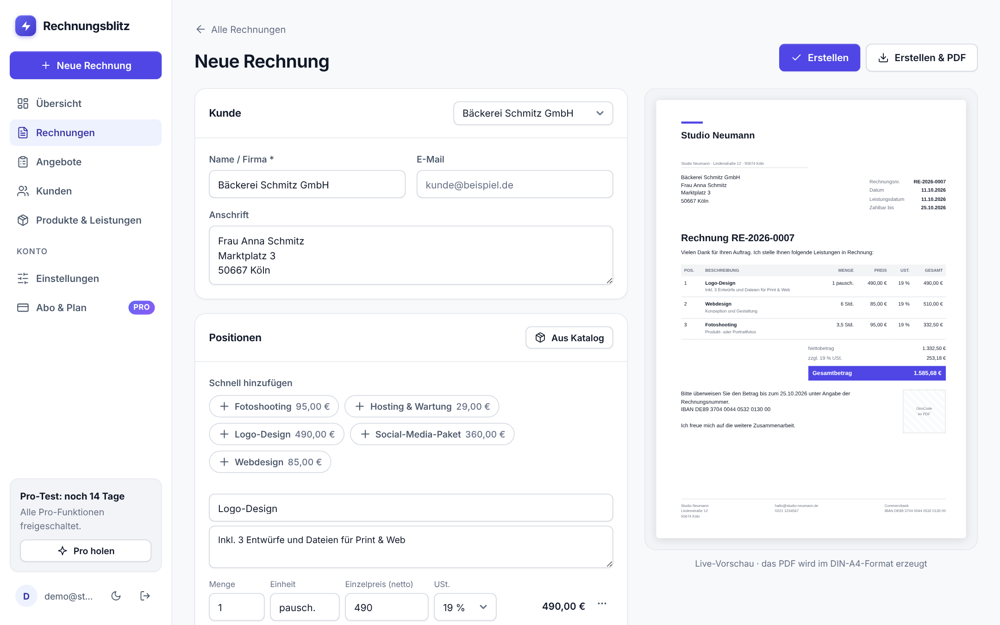

# ⚡ Rechnungsblitz

**Rechnungen und Angebote online schreiben – als SaaS mit kostenlosem Starter-Plan und Pro-Abo.**

Zielgruppe: Freelancer, Kleinunternehmer, Kreative, Handwerk, Nebengewerbe. Nutzer legen ein Konto an,
testen 14 Tage alle Pro-Funktionen (ohne Kreditkarte) und nutzen danach entweder den kostenlosen
Starter-Plan oder schließen das Pro-Abo über Stripe ab.



## Funktionen

| | Starter (0 €) | Pro (6,99 €/Monat oder 59 €/Jahr) |
|---|---|---|
| Rechnungen & Angebote pro Monat | 3 | unbegrenzt |
| Kunden & Produkte speichern | je 5 | unbegrenzt |
| PDF im DIN-5008-Layout, Live-Vorschau | ✓ | ✓ |
| Angebot → Rechnung per Klick, Duplizieren | ✓ | ✓ |
| Status offen / bezahlt / überfällig / storniert | ✓ | ✓ |
| GiroCode (Zahlung per QR-Scan) | – | ✓ |
| Eigenes Logo & Markenfarbe | – | ✓ |
| Ohne „Erstellt mit Rechnungsblitz“-Hinweis | – | ✓ |
| Zahlungserinnerung als PDF | – | ✓ |
| CSV-Export für die Steuer | – | ✓ |

Außerdem enthalten:
- **Produktkatalog**: Leistungen einmal anlegen, dann per Chip, über den Katalog-Dialog oder per Autovervollständigung in die Rechnung übernehmen. Jede Position lässt sich auch direkt „als Produkt speichern“.
- **Kundenverwaltung**: Kunden auswählen oder beim Schreiben direkt mitspeichern.
- **Steuern**: 19 %, 7 % und 0 % pro Position, Netto/Brutto, Rabatt, Kleinunternehmer-Modus nach § 19 UStG.
- **Fortlaufende Nummern** mit eigenem Präfix (z. B. `RE-{JAHR}-0001`).
- **Übersicht**: Umsatz, Zahlungseingänge, offene und überfällige Beträge, Umsatzdiagramm über 6 Monate, Onboarding-Checkliste.
- **Konto**: Passwort ändern, kompletter Datenexport (JSON) und Konto löschen (DSGVO).
- **Design**: hell und dunkel, Handy-tauglich, Schrift Inter vom eigenen Server (keine Google-Fonts).
- **Sicherheit**: scrypt-Passwort-Hashes, HttpOnly-Session-Cookies, CSRF-Schutz (nur JSON + SameSite), Begrenzung der Login-Versuche, Content-Security-Policy, Grenzen werden serverseitig geprüft.

## Lokal starten

Voraussetzung: **Node.js ab 22.13** ([nodejs.org](https://nodejs.org), LTS-Version).

```bash
npm install
npm start        # → http://localhost:3000
npm test         # automatische Tests
```

Ohne Stripe-Schlüssel läuft die App im **Testmodus**: „Pro holen“ schaltet Pro sofort und ohne Zahlung frei,
„Abo verwalten“ setzt wieder auf Starter zurück. Zum Neustart mit leerer Datenbank: Server stoppen und `data.db*` löschen.

## Echte Zahlungen aktivieren (Stripe)

1. Konto bei [stripe.com](https://stripe.com) anlegen.
2. Ein Produkt „Rechnungsblitz Pro“ mit **zwei wiederkehrenden Preisen** anlegen: 6,99 €/Monat und 59 €/Jahr.
   Wenn du andere Preise willst, passe auch `PRICES` in `lib/plans.js` an. Von dort holen Landingpage und App die angezeigten Preise.
3. `.env.example` nach `.env` kopieren und `STRIPE_SECRET_KEY`, `STRIPE_PRICE_MONTHLY`, `STRIPE_PRICE_YEARLY` und `BASE_URL` eintragen.
4. Einen **Webhook** auf `https://deine-domain.de/api/stripe/webhook` einrichten, mit den Events
   `checkout.session.completed` und `customer.subscription.created`, `.updated` und `.deleted`. Das Signing-Secret kommt in `STRIPE_WEBHOOK_SECRET`.
   Lokal geht das mit `stripe listen --forward-to localhost:3000/api/stripe/webhook`.
5. Das **Kundenportal** in Stripe aktivieren (Einstellungen → Billing → Kundenportal). Darüber kündigen Kunden selbst.
6. Zuerst mit Test-Keys und der Testkarte `4242 4242 4242 4242` ausprobieren, danach auf Live-Keys umstellen.

## Online stellen

Jeder Node-Hoster funktioniert (Render, Railway, Fly.io, Hetzner-VPS …). Ein `Dockerfile` liegt bei.

- Die **Datenbank muss auf einem dauerhaften Speicher liegen** (Volume): `DB_PATH=/data/data.db`.
- `BASE_URL` auf die echte `https://`-Adresse setzen. Dann werden Cookies automatisch als `Secure` markiert.
- Hinter dem Proxy des Hosters `TRUST_PROXY=1` setzen, damit die Login-Begrenzung die echte IP sieht.
- Regelmäßige **Backups** der Datenbankdatei einrichten.

## Vor dem Start mit echten Kunden

- [ ] Gewerbe anmelden (unter 18: Zustimmung der Eltern und des Familiengerichts)
- [ ] `public/impressum.html`, `public/datenschutz.html` und `public/agb.html` ausfüllen und rechtlich prüfen lassen (die gelb markierten Stellen)
- [ ] Widerrufsbelehrung ergänzen, falls du an Verbraucher verkaufst
- [ ] Stripe-Konto verifizieren, Live-Keys eintragen
- [ ] Eigene Domain und HTTPS einrichten
- [ ] Datenbank-Backups einrichten

## Ideen für die nächsten Ausbaustufen

- **E-Rechnung (XRechnung/ZUGFeRD)**: wird für B2B-Rechnungen in Deutschland ab 2027/2028 Pflicht (Kleinunternehmer sind ausgenommen). Das wäre das stärkste Verkaufsargument für Pro.
- „Passwort vergessen“ und Rechnungsversand per E-Mail (braucht einen E-Mail-Dienst, z. B. Postmark oder Brevo)
- Wiederkehrende Rechnungen (z. B. monatliches Hosting automatisch)
- Mehrere Steuersätze für Auslandskunden (Reverse Charge)
- Team-Zugänge, Belege und Ausgaben erfassen

## Aufbau

```
server.js            Express-App: Sicherheits-Header, Routen, statische Dateien
db.js                SQLite-Schema (in Node eingebaut, keine Installation nötig)
lib/
  calc.js            Summen & Steuern – gemeinsam für Server und Browser-Vorschau
  pdf.js             PDF-Erzeugung (Rechnung, Angebot, Zahlungserinnerung)
  girocode.js        EPC-QR-Code + IBAN-Prüfung
  plans.js           Pläne, Grenzen, Testphase, Preise
  settings.js        Firmendaten, Nummernkreise
  auth.js            Passwörter, Sessions, Login-Begrenzung
routes/
  account.js         Registrierung, Login, Konto, Datenexport
  data.js            Kunden, Produkte, Belege, PDF, Statistik, CSV
  billing.js         Stripe-Checkout, Kundenportal, Webhook
public/
  index.html         Landingpage
  login.html         Anmelden / Registrieren
  app.html           Die App (Single-Page, ES-Module ohne Build-Schritt)
  js/app/views/      Übersicht, Rechnungen, Editor, Kunden, Produkte, Einstellungen, Abo
  css/               Design-System (base), App, Landingpage, Login, Rechtstexte
test/api.test.js     API-Tests (Limits, Steuern, Rechte, Sicherheit)
```
